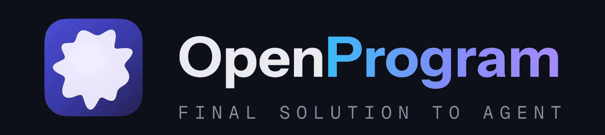
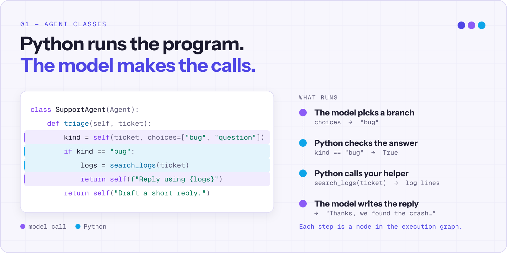
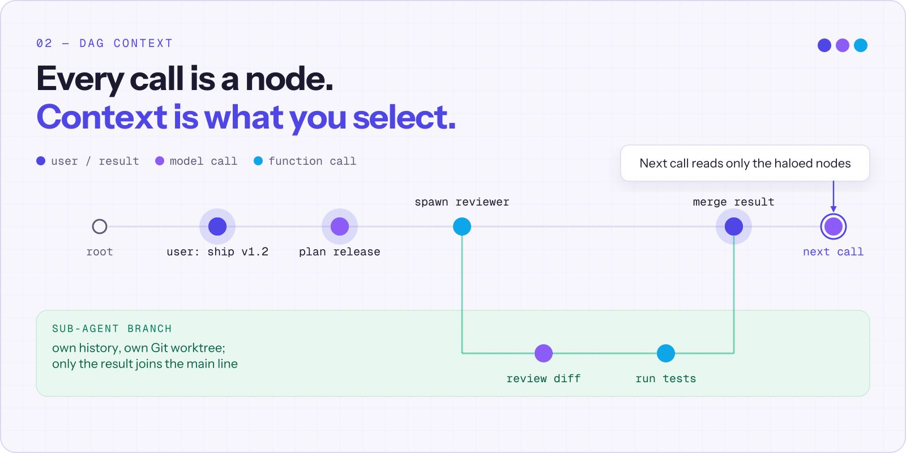
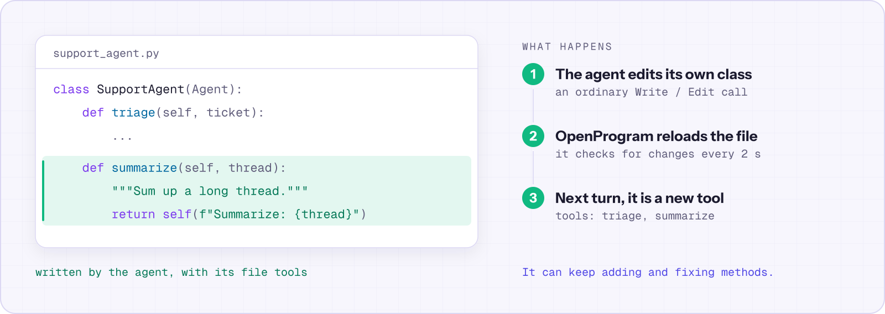

<p align="center">
  <picture>
    <source media="(prefers-color-scheme: dark)" srcset="docs/images/logo-lockup.gif">
    <source media="(prefers-color-scheme: light)" srcset="docs/images/logo-lockup-light.gif">
    
  </picture>
</p>


# OpenProgram

<!-- Compatibility anchors for existing incoming links. -->
<a id="1-agentic-function-the-primitive-everything-else-is-built-on"></a>
<a id="2-dag-context-for-native-multi-agent-systems"></a>
<a id="3-agentic-workflow-for-trustworthy-self-evolving-agents"></a>
<a id="4-event-infrastructure-for-proactive-agents"></a>

<a id="integrated-projects"></a>
<a id="why-openprogram"></a>
<a id="1-agentic-function--the-primitive-everything-else-is-built-on"></a>
<a id="2-dag-context--for-native-multi-agent-systems"></a>
<a id="3-agentic-workflow--for-trustworthy--self-evolving-agents"></a>
<a id="4-event-infrastructure--for-proactive-agents"></a>
<a id="also-in-the-product"></a>


<p align="center"><b>Self-Programming AI Assistant. Capture, automate, and refine all your workflows.</b></p>

<p align="center">
  <a href="https://arxiv.org/abs/2606.15874"></a>
  <a href="https://github.com/fzkuji-neo/OpenProgram"></a>
  <a href="https://github.com/fzkuji-neo/OpenProgram/blob/main/LICENSE"></a>
  <a href="https://www.python.org/"></a>
  
  <a href="https://github.com/fzkuji-neo/OpenProgram/actions/workflows/ci.yml"></a>
</p>


<p align="center">
  <a href="README.md">English</a> · <a href="README.zh.md">简体中文</a> · <a href="docs/README.md">Documentation</a> · <a href="docs/reference/API.md">API</a> · <a href="https://arxiv.org/abs/2606.15874">Paper</a>
</p>

OpenProgram is an AI assistant and a Python framework in one. In the framework, Python owns the control flow, validation and recovery, and the model is called only where judgment or writing is needed. Every call lands in an execution graph you can inspect, branch and reuse. The assistant runs on the same runtime: a desktop and web workspace where chats, files, a terminal and a built-in browser sit side by side, and the agent can work in all of them.

- **It programs itself.** Agents write and revise their own methods as Python files, and a watcher loads each change for the next turn.
- **Agents as programs.** An agent is a Python class. Branches, loops and checks are ordinary code; `self(...)` is a model call.
- **A graph, not a transcript.** User turns, model calls and function calls are nodes. Context is a selection of nodes, so sub-agents get their own branch and hand back only their result.
- **Checked decisions.** The model proposes, code validates, and a bad pick goes back for another try instead of running.
- **One workspace.** Chat, files, terminal and a browser the agent can drive, in split panes, on macOS, Windows, Linux or a server.
- **Any model.** Anthropic, OpenAI, Gemini, local inference servers and more, with several accounts per provider.

## Install

macOS and Linux:

```bash
curl -fsSL https://openprogram.io/install | sh
```

Windows x86_64 or arm64 CLI and server, when the selected release includes its runtime assets:

```powershell
irm https://openprogram.io/install.ps1 | iex
```

The macOS desktop App ships as a signed, notarized DMG. Windows desktop installers are available when a signed `win-x64.exe` or `win-arm64.exe` is attached to the [release](https://github.com/fzkuji-neo/OpenProgram/releases). See [installation](docs/install/install.md) for platform requirements, source installation and troubleshooting.

## Quick start

Start the setup wizard and the terminal chat:

```bash
openprogram
```

Open the browser interface at http://localhost:18100:

```bash
openprogram web
```

Check the configured provider with one reply:

```bash
openprogram --print "Introduce yourself in one sentence"
```

Run `openprogram setup` to change provider settings. Continue with [getting started](docs/start/GETTING_STARTED.md), [model configuration](docs/models/README.md) or the [documentation overview](docs/README.md).

## How it works

### Agent classes

<p align="center">
  <picture>
    <source media="(prefers-color-scheme: dark)" srcset="docs/images/highlights/00-agent-class.svg">
    <source media="(prefers-color-scheme: light)" srcset="docs/images/highlights/00-agent-class-light.svg">
    
  </picture>
</p>

An agent is a Python class with ordinary methods. The docstring describes the call, the arguments carry the data, and `self(...)` asks the model. Branching, retries and checks stay in Python, so the parts that must happen always happen.

```python
from openprogram import Agent

class SupportAgent(Agent):
    def triage(self, ticket: str) -> str:
        """Classify the ticket, then draft a reply."""
        kind = self(ticket, choices=["bug", "question"])
        if kind == "bug":
            logs = search_logs(ticket)  # your own helper
            return self(f"Reply using:\n{logs}")
        return self("Draft a short reply.")

reply = SupportAgent().triage("The export button crashes the app.")
```

See [writing agents](docs/capabilities/agentic-programming/writing-functions/agent.md) and the [Agent reference](docs/reference/api/agent.md).

### DAG context

<p align="center">
  <picture>
    <source media="(prefers-color-scheme: dark)" srcset="docs/images/highlights/01-dag-context.svg">
    <source media="(prefers-color-scheme: light)" srcset="docs/images/highlights/01-dag-context-light.svg">
    
  </picture>
</p>

User turns, model calls and function calls are recorded as nodes in one graph. Each call reads a selection of earlier nodes rather than a growing private transcript. A sub-agent runs on its own branch, optionally in its own Git worktree, and only its result joins the main line. Branches also let you retry from any point or keep alternative histories. See [context](docs/reference/design/context/README.md) and [collaboration](docs/reference/design/runtime/agent-collaboration.md).

### Self-evolving agents

<p align="center">
  <picture>
    <source media="(prefers-color-scheme: dark)" srcset="docs/images/highlights/02-self-evolving.svg">
    <source media="(prefers-color-scheme: light)" srcset="docs/images/highlights/02-self-evolving-light.svg">
    
  </picture>
</p>

An agent can write and revise the methods of its own `Agent` class with ordinary file tools. A watcher checks the files every two seconds and reloads eligible changes, so a new method is available as a tool from the next turn. See [workflows](docs/capabilities/agentic-workflow.md).

### Checked decisions

`decision.make(prompt, options)` offers the model a fixed menu. Code checks the pick before anything runs, and an unknown option or bad argument goes back to the model to choose again. See [choosing the next step](docs/capabilities/agentic-programming/choosing-the-next-step/next-step-decision.md).

### Events

One process-wide bus carries typed events from the agent loop, context, files, channels and memory. Subscribers observe the event types they ask for, and a plugin can subscribe to `tool.before` as a gate that allows or denies a tool call.

```python
from openprogram.events import get_event_bus

unsubscribe = get_event_bus().subscribe(
    lambda event: print(event.type, event.payload),
    types={"context.compacted", "file.changed"},
)
# Call unsubscribe() when the subscriber is no longer needed.
```

See [events](docs/reference/design/proactive/event-layer.md), [plugins](docs/capabilities/plugins.md) and [feature status](docs/reference/design/feature-matrix.html).

## What you can do with it

| | |
|---|---|
| **[Desktop App and built-in browser](docs/interfaces/desktop.md)** | Split chats, files, terminals and web pages into panes. The agent reads and operates pages in the built-in browser while you watch. |
| **[Computer use](docs/capabilities/computer-use.md)** | Let the agent operate desktop apps, built-in browser pages or a remote VM, step by step or as a task handed to a new agent. |
| **[Permissions](docs/capabilities/permissions.md)** | Approve, deny or deny with a note before a tool runs; the model reads your note and adjusts. |
| **[Memory](docs/capabilities/memory.md)** | Stored evidence, retrieval and background writing across conversations. |
| **[Goals](docs/capabilities/goal.md)** | Keep a long-running objective alive across ordinary conversations. |
| **[Agents](docs/capabilities/agents.md)** | Save a model, instructions, capabilities and memory access as a reusable Agent. |
| **[Channels](docs/integrations/channels.md)** | Talk to your agents from Telegram, Discord, Slack and WeChat. |
| **[Models](docs/models/providers.md)** | Anthropic, OpenAI, Gemini, [local servers](docs/models/local-models.md) and multiple accounts per provider. |
| **[Skills](docs/capabilities/skills.md), [MCP](docs/capabilities/mcp.md) and [plugins](docs/capabilities/plugins.md)** | Extend what the agent knows and which tools it can call. |
| **[Interfaces](docs/interfaces/README.md)** | Desktop App, web UI, terminal UI, CLI and ACP. |

## Related projects

| Project | Purpose |
|---|---|
| [GUI Agent Harness](https://github.com/Fzkuji/GUI-Agent-Harness) | Desktop automation through screenshots and actions. |
| [Research Agent Harness](https://github.com/Fzkuji/Research-Agent-Harness) | Literature review, experiments and paper preparation. |
| [Scriptorium](https://github.com/Fzkuji/Scriptorium) | Source-cited Markdown memory through MCP. |

Install programs with `openprogram programs install <owner>/<repo>`. See [program installation](docs/capabilities/installing-harnesses.md).

## News

- 2026-10-11: deny with a note: a declined approval carries your reason to the model.
- 2026-10-11: split view tiles like macOS windows, with a Mission Control style overview.
- 2026-10-01: local inference servers, with optional authentication.
- 2026-09-30: configurable Agents with scoped memory.
- 2026-08-17: built-in browser with panes, bookmarks, history and agent interaction.
- 2026-07-21: sub-agents, cross-session messaging and Git worktree isolation.
- 2026-06-22: paper accepted at the KDD 2026 Workshop on Agentic Software Engineering.
- 2026-06-07: installable programs and multiple provider accounts with key rotation.
- 2026-04-03: initial release with agentic functions and an execution DAG.

## Citation

LLM-as-Code: Agentic Programming for Agent Harness. KDD 2026 Workshop on Agentic Software Engineering (AgenticSE). [arXiv:2606.15874](https://arxiv.org/abs/2606.15874).

```bibtex
@inproceedings{qi2026llmascode,
  title     = {LLM-as-Code: Agentic Programming for Agent Harness},
  author    = {Qi, Junjia and Fu, Zichuan and Gao, Jingtong and Zhang, Wenlin and Yan, Hanyu and Wu, Xian and Zhao, Xiangyu},
  booktitle = {KDD 2026 Workshop on Agentic Software Engineering (AgenticSE)},
  year      = {2026},
  eprint    = {2606.15874},
  archivePrefix = {arXiv},
  url       = {https://arxiv.org/abs/2606.15874},
}
```

## License

[AGPL-3.0](LICENSE) © 2026 Fzkuji. See the license for use, modification, distribution and network-service obligations.

## Acknowledgements

Thanks to contributors who provide code, reports, reproductions, tests, documentation and reviews.

<!-- contributors-avatars -->
<p>
<a href="https://github.com/fzkuji-neo"></a>
<a href="https://github.com/Qi202"></a>
<a href="https://github.com/GithungDang"></a>
<a href="https://github.com/basil-k-aji-dev"></a>
<a href="https://github.com/binyangzhu000-sudo"></a>
</p>
<!-- /contributors-avatars -->

[Issues](https://github.com/fzkuji-neo/OpenProgram/issues) · [Pull requests](https://github.com/fzkuji-neo/OpenProgram/pulls)
