<p align="center">
  <picture>
    <source media="(prefers-color-scheme: dark)" srcset="docs/images/logo-lockup.gif">
    <source media="(prefers-color-scheme: light)" srcset="docs/images/logo-lockup-light.gif">
    
  </picture>
</p>


# OpenProgram

<p align="center"><b>自编程 AI 助手：记录、自动化并持续改进你的所有工作流。</b></p>

<p align="center">
  <a href="https://arxiv.org/abs/2606.15874"></a>
  <a href="https://github.com/fzkuji-neo/OpenProgram"></a>
  <a href="https://github.com/fzkuji-neo/OpenProgram/blob/main/LICENSE"></a>
  <a href="https://www.python.org/"></a>
  
  <a href="https://github.com/fzkuji-neo/OpenProgram/actions/workflows/ci.yml"></a>
</p>


<p align="center">
  <a href="README.md">English</a> · <a href="README.zh.md">简体中文</a> · <a href="docs/README.zh.md">文档</a> · <a href="docs/reference/API.zh.md">API</a> · <a href="https://arxiv.org/abs/2606.15874">论文</a>
</p>

OpenProgram 既是 AI 助手，也是 Python 框架。在框架里，控制流程、验证和恢复由 Python 负责，只在需要判断或写作的地方调用模型。每次调用都记录在执行图里，可以查看、分支和复用。助手跑在同一套运行时上：桌面端和网页端的工作区把聊天、文件、终端和内置浏览器并排放在一起，Agent 可以在其中任意一处工作。

- **它会给自己编程。** Agent 以 Python 文件的形式编写和修改自己的方法，watcher 把每次改动加载到下一轮。
- **Agent 就是程序。** 一个 Agent 是一个 Python 类。分支、循环和检查都是普通代码，`self(...)` 就是一次模型调用。
- **是图，不是聊天记录。** 用户消息、模型调用和函数调用都是节点。上下文是对节点的选择，所以子 Agent 有自己的分支，只把结果交回来。
- **决策先检查。** 模型提出选择，代码先验证；选错了就退回重选，而不是直接执行。
- **一个工作区。** 聊天、文件、终端和 Agent 可以操作的浏览器分屏并排，支持 macOS、Windows、Linux 和服务器。
- **模型随意换。** Anthropic、OpenAI、Gemini、本地推理服务等，每个服务商可以配置多个账号。

## 安装

macOS 和 Linux：

```bash
curl -fsSL https://openprogram.io/install | sh
```

Windows x86_64 或 arm64 CLI／服务端需要所选发行版包含对应运行时：

```powershell
irm https://openprogram.io/install.ps1 | iex
```

macOS 桌面 App 以经过签名和公证的 DMG 发布。Windows 桌面安装包在[发行页](https://github.com/fzkuji-neo/OpenProgram/releases)包含已签名的 `win-x64.exe` 或 `win-arm64.exe` 时可用。平台要求、源码安装和故障排查见[安装说明](docs/install/install.zh.md)。

## 快速开始

启动配置向导和终端聊天：

```bash
openprogram
```

打开浏览器界面，地址为 http://localhost:18100：

```bash
openprogram web
```

通过一次回复检查模型服务配置：

```bash
openprogram --print "请用一句话介绍你自己"
```

使用 `openprogram setup` 修改模型服务设置。继续阅读[快速上手](docs/start/GETTING_STARTED.zh.md)、[模型配置](docs/models/README.zh.md)或[文档总览](docs/README.zh.md)。

## 工作原理

### Agent 类

<p align="center">
  <picture>
    <source media="(prefers-color-scheme: dark)" srcset="docs/images/highlights/00-agent-class.svg">
    <source media="(prefers-color-scheme: light)" srcset="docs/images/highlights/00-agent-class-light.svg">
    
  </picture>
</p>

Agent 是一个带普通方法的 Python 类。docstring 描述这次调用，参数携带数据，`self(...)` 向模型提问。分支、重试和检查都留在 Python 里，必须发生的步骤一定会发生。

```python
from openprogram import Agent

class SupportAgent(Agent):
    def triage(self, ticket: str) -> str:
        """Classify the ticket, then draft a reply."""
        kind = self(ticket, choices=["bug", "question"])
        if kind == "bug":
            logs = search_logs(ticket)  # 你自己的辅助函数
            return self(f"Reply using:\n{logs}")
        return self("Draft a short reply.")

reply = SupportAgent().triage("The export button crashes the app.")
```

参见[编写 Agent](docs/capabilities/agentic-programming/writing-functions/agent.zh.md) 和 [Agent 参考](docs/reference/api/agent.zh.md)。

### DAG 上下文

<p align="center">
  <picture>
    <source media="(prefers-color-scheme: dark)" srcset="docs/images/highlights/01-dag-context.svg">
    <source media="(prefers-color-scheme: light)" srcset="docs/images/highlights/01-dag-context-light.svg">
    
  </picture>
</p>

用户消息、模型调用和函数调用都作为节点记录在同一张图里。每次调用读取的是从已有节点中选出的一部分，而不是一份不断变长的私有对话记录。子 Agent 在自己的分支上运行，可以使用独立的 Git worktree，只有结果会并回主线。分支也让你可以从任意位置重试，或保留多条不同的执行历史。参见[上下文](docs/reference/design/context/README.zh.md)和[协作](docs/reference/design/runtime/agent-collaboration.zh.md)。

### 工作流

<p align="center">
  <picture>
    <source media="(prefers-color-scheme: dark)" srcset="docs/images/highlights/02-agentic-workflow.svg">
    <source media="(prefers-color-scheme: light)" srcset="docs/images/highlights/02-agentic-workflow-light.svg">
    
  </picture>
</p>

`decision.make(prompt, options)` 给模型一份固定的选项菜单。代码在执行前检查模型的选择，未知选项或错误参数会退回给模型重选。Agent 还能用普通文件工具编写和修改自己的 `Agent` 方法文件；watcher 重新加载符合条件的改动，新方法从下一轮起就能使用。参见[工作流](docs/capabilities/agentic-workflow.zh.md)和[选择下一步](docs/capabilities/agentic-programming/choosing-the-next-step/next-step-decision.zh.md)。

### 事件

<p align="center">
  <picture>
    <source media="(prefers-color-scheme: dark)" srcset="docs/images/highlights/03-event-infrastructure.svg">
    <source media="(prefers-color-scheme: light)" srcset="docs/images/highlights/03-event-infrastructure-light.svg">
    
  </picture>
</p>

一条进程级总线承载来自 Agent 循环、上下文、文件、渠道和记忆的类型化事件。订阅者只观察自己指定的事件类型；插件可以把 `tool.before` 订阅为闸门，允许或拒绝一次工具调用。

```python
from openprogram.events import get_event_bus

unsubscribe = get_event_bus().subscribe(
    lambda event: print(event.type, event.payload),
    types={"context.compacted", "file.changed"},
)
# 不再需要时调用 unsubscribe()。
```

参见[事件](docs/reference/design/proactive/event-layer.zh.md)、[插件](docs/capabilities/plugins.zh.md)和[功能状态](docs/reference/design/feature-matrix.html)。

## 能用它做什么

| | |
|---|---|
| **[桌面 App 与内置浏览器](docs/interfaces/desktop.zh.md)** | 把聊天、文件、终端和网页分屏排开。Agent 在内置浏览器里读取和操作网页，你可以在旁边看着。 |
| **[GUI Agent](docs/capabilities/workflows/gui-agent.zh.md)** | 把需要操作桌面、浏览器页面或远程虚拟机的任务交给它。 |
| **[权限](docs/capabilities/permissions.zh.md)** | 工具运行前批准、拒绝，或拒绝并附上说明；模型会读到你的说明并调整做法。 |
| **[记忆](docs/capabilities/memory.zh.md)** | 跨会话保存证据、检索，并在后台整理写入。 |
| **[目标](docs/capabilities/goal.zh.md)** | 让一个长期目标在普通对话之间持续推进。 |
| **[Agent 配置](docs/capabilities/agents.zh.md)** | 把模型、指令、能力和记忆权限保存成可复用的 Agent。 |
| **[聊天渠道](docs/integrations/channels.zh.md)** | 在 Telegram、Discord、Slack 和微信里和你的 Agent 对话。 |
| **[模型](docs/models/providers.zh.md)** | Anthropic、OpenAI、Gemini、[本地推理服务](docs/models/local-models.zh.md)，每个服务商可配置多个账号。 |
| **[Skills](docs/capabilities/skills.zh.md)、[MCP](docs/capabilities/mcp.zh.md) 和[插件](docs/capabilities/plugins.zh.md)** | 扩展 Agent 掌握的知识和可调用的工具。 |
| **[界面](docs/interfaces/README.zh.md)** | 桌面 App、网页界面、终端界面、CLI 和 ACP。 |

## 相关项目

| 项目 | 用途 |
|---|---|
| [GUI Agent Harness](https://github.com/Fzkuji/GUI-Agent-Harness) | 通过截图和操作实现桌面自动化。 |
| [Research Agent Harness](https://github.com/Fzkuji/Research-Agent-Harness) | 文献调研、实验和论文准备。 |
| [Scriptorium](https://github.com/Fzkuji/Scriptorium) | 通过 MCP 提供带来源引用的 Markdown 记忆。 |

使用 `openprogram programs install <owner>/<repo>` 安装程序。参见[安装程序](docs/capabilities/installing-harnesses.zh.md)。

## 动态

- 2026-10-11：拒绝并说明原因：被拒绝的审批会把你的理由交给模型。
- 2026-10-11：分屏像 macOS 窗口一样平铺，并提供类似调度中心的窗口总览。
- 2026-10-01：支持本地推理服务，可选身份验证。
- 2026-09-30：可配置的 Agent 与分范围的记忆。
- 2026-08-17：内置浏览器，支持分屏、书签、历史记录和 Agent 交互。
- 2026-07-21：子 Agent、跨会话消息和 Git worktree 隔离。
- 2026-06-22：论文被 KDD 2026 Agentic Software Engineering Workshop 接收。
- 2026-06-07：可安装程序，以及支持密钥轮换的多服务商账号。
- 2026-04-03：首次发布，包含 agentic 函数和执行 DAG。

## 引用

LLM-as-Code: Agentic Programming for Agent Harness。KDD 2026 Workshop on Agentic Software Engineering (AgenticSE)。[arXiv:2606.15874](https://arxiv.org/abs/2606.15874)。

```bibtex
@inproceedings{qi2026llmascode,
  title     = {LLM-as-Code: Agentic Programming for Agent Harness},
  author    = {Qi, Junjia and Fu, Zichuan and Gao, Jingtong and Zhang, Wenlin and Yan, Hanyu and Wu, Xian and Zhao, Xiangyu},
  booktitle = {KDD 2026 Workshop on Agentic Software Engineering (AgenticSE)},
  year      = {2026},
  eprint    = {2606.15874},
  archivePrefix = {arXiv},
  url       = {https://arxiv.org/abs/2606.15874},
}
```

## 许可证

[AGPL-3.0](LICENSE) © 2026 Fzkuji。使用、修改、分发和网络服务的义务以许可证全文为准。

## 致谢

感谢提供代码、问题报告、复现、测试、文档和审查的贡献者。

<!-- contributors-avatars -->
<p>
<a href="https://github.com/fzkuji-neo"></a>
<a href="https://github.com/Qi202"></a>
<a href="https://github.com/GithungDang"></a>
<a href="https://github.com/basil-k-aji-dev"></a>
<a href="https://github.com/binyangzhu000-sudo"></a>
</p>
<!-- /contributors-avatars -->

[问题反馈](https://github.com/fzkuji-neo/OpenProgram/issues) · [拉取请求](https://github.com/fzkuji-neo/OpenProgram/pulls)
