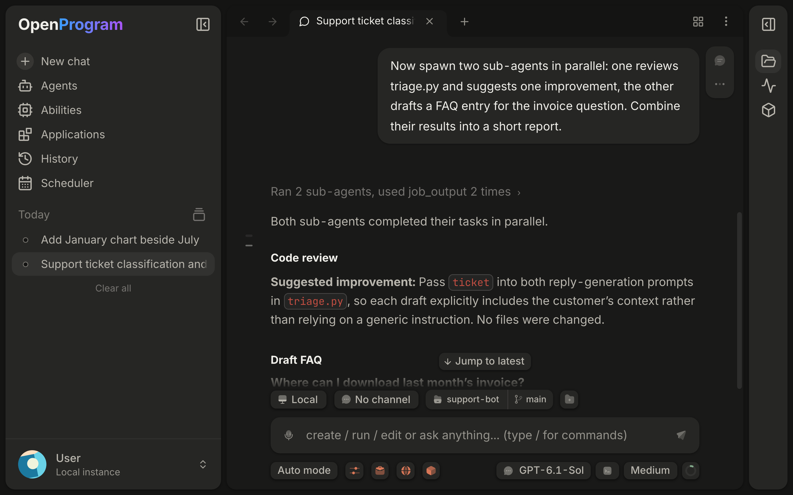

# Web UI

Opening a conversation after restarting or refreshing the app shows the latest messages. Within the same run, returning less than one hour after leaving restores your reading state: a conversation left at the bottom follows new messages and delayed layout; a conversation scrolled into history restores that position. Returning after at least one hour away shows latest. The same one-hour rule applies after the app loses focus. There is no timer that moves a conversation while you are reading it; scrolling upward cancels following. Successfully loaded file-change summaries remain available when you return to the conversation, while file history actions still check the current state.

Conversation menus provide **Copy link** for the selected conversation. The desktop App uses the native clipboard; the browser uses its clipboard API with a selection fallback. A success notification appears only after copying succeeds.

Select text within a chat message and choose **Add to chat**, or use **Quote message** in its action row. The quote is appended to that conversation’s draft without sending it. In split view, each pane quotes into its own composer. Choose **Edit message** on a user message to change its text and URLs, remove existing attachments, or pick, paste and drop images and files. File mentions work with `@`. **Save & resend** creates a new branch; the original message remains available. Press Cmd/Ctrl+Enter to save or Escape to cancel. Failed saves keep your edits and attachments for retry.

Open the conversation’s ⋯ menu and choose **Auto rename** to generate a name from its content using the model you used last. **Rename** still lets you type a name. The current name remains visible while generation runs; failures keep it unchanged. An explicitly chosen name is protected from background automatic naming. This action is also available in the chat pane’s session menu. It does not send a chat message or run tools.

Each tab keeps its own Back and Forward history, beginning with its default launcher. Navigation normally restores pages inside the selected tab; switching tabs adds no history. Non-conversation destinations can be opened independently from another launcher. Choosing a new destination after Back replaces only that tab’s forward history. History is saved with the tab. Browser controls handle navigation between webpage URLs.

The floating webpage preview in the desktop App displays the same live page. Click, scroll and type directly in it; drag its title bar to move it, or its edges to resize it. While the pointer is held, the current frame moves or scales with the window; live page updates and interaction resume when you release it. The page viewport stays at 1920 × 1080 CSS pixels; resizing the preview changes only its display scale and leaves unused space blank. Page layout and Agent coordinates remain stable. Opening it in a full tab restores normal window sizing and your page zoom. Open page moves the same page to a full tab; hiding the preview keeps the page available in Resources. In a regular browser, the preview embeds a separate page in a sandboxed iframe. Websites may block embedding, and this iframe does not share the desktop Page state; use Open page when needed. The preview hides the page’s outer scrollbar tracks while retaining wheel and keyboard scrolling; opening the full tab restores its normal scrollbars. Moving the preview does not reconfigure page scaling.

**Operation history** opens a menu in the current page in both the desktop App and browser. Focus its button and press Enter or Space to open it; Escape closes the menu and returns focus to the button.

Opening a conversation already displayed in this window selects its existing tab, including when opening from a launcher or another conversation. Otherwise a session tab or launcher is reused. Back and Forward also select an existing conversation tab when their destination is already open, preserving the source history. Conversation IDs determine uniqueness; identical titles do not. Reloading older duplicate tabs retains the active instance, or the first instance if none is active, with its history and group; other duplicate slots are removed. Draft input and background title updates survive navigation and reload; deleted sessions are removed from every history.

When Files or a file tab is active, Back and Forward revisit the folders and files you opened in the current project. Returning to Files restores its expanded folders and scroll position. Opening a new location after going back replaces the forward steps. File locations belong to this tab’s saved page history, separate from document version History. Refreshing a stale directory listing keeps existing rows visible while the loaded range is replaced.

A Markdown file opens as a rendered document. Relative image paths such as `figures/a.png` load from the document's own folder, and a relative link opens the linked file in its own tab. Raw HTML in the file is shown as text, not run. A link such as `#installation` scrolls within that document; `guide.md#installation` opens the target file and scrolls after its content loads. Heading keys use lowercase visible text, keep Unicode letters and numbers, replace spaces with hyphens, and assign numeric suffixes to duplicates. Section requests are temporary and are not restored after reopening the app. Navigation preserves unsaved text.

The document is laid out like Obsidian's reading view: the file name appears as a title, and YAML frontmatter appears as a **Properties** table, with list values such as `tags` shown as pills. Obsidian syntax is rendered too:

- `> [!note] Title` callouts, in the standard kinds (note, tip, warning, danger, and so on). `> [!tip]-` starts folded and `> [!tip]+` starts open; click the title to toggle.
- `==text==` highlights and `#tag` tags.
- `[[Note]]`, `[[Note#Heading]]` and `[[Note|label]]` link to `Note.md` in the document's own folder, or the folder written before the name, and open it in its own tab.
- `![[image.png]]` embeds an image from the same place; `![[image.png|300]]` sets its width. Embedding another note shows a link instead.

Wikilinks are not searched for across the whole folder tree the way Obsidian resolves them, and there is no outline.

In the desktop App, an HTML file opens as a web page in a browser tab: the file card in a reply opens it beside its conversation, and **View page** in a file tab opens the saved file. The page loads from disk through a `file://` address, so stylesheets, images and scripts next to it load and run as they would in Chrome. **View source** in that tab's toolbar returns to the file, where Edit and History work as usual; the file tab's first button reads **Source**. In a regular browser, or when the worker runs on another machine, HTML files stay source files.

PDF files open in a continuous reader with page navigation, thumbnails, document outlines, fit-to-width or fit-to-page zoom, selectable text, search highlighting and original-file download. Copying selected text removes layout line breaks by default while retaining paragraphs and ordinary hyphens; disable this option to preserve the original line breaks. Project files support highlights and text notes, saved as standard PDF annotations through the document save and History controls. Attachments and historical versions remain read-only. The PDF decoder is included locally and supports the bundled desktop runtime; opening a PDF does not upload it to an external viewer. Preview input is limited to 64 MiB.

The project menu also reveals its folder in the system file manager, creates a permanent Git worktree, archives its chats, or removes its sidebar entry. Worktrees use a new branch from the current commit and a new absolute folder outside the source Git checkout; uncommitted changes stay in the original folder. While the worktree is made, the dialog names the step (creating the branch, checking out files with a percentage on large repositories, opening the project); **Stop** during the checkout removes the half-made folder and its branch. Removing a project preserves files, chats, and project ownership. Restore it from the Projects page or reopen its folder. The default home project cannot be removed. Archived chats remain available through the Archived filter; hidden project chats remain in date/flat history.

When the project folder or an additional working folder is inside a Git checkout, its pill in the composer gains a git half showing the branch and the uncommitted line counts as a green and red badge. When the row is crowded, names shorten, then branch names hide, then the badge becomes a half-green, half-red dot. Its menu opens the changes in Review, switches to or creates a branch, and moves the folder onto another worktree or a new one created beside the repository. A started conversation's main folder is fixed, so a worktree chosen there joins as an additional working folder. **Create pull request** pushes the branch and runs `gh pr create --fill`; it needs the GitHub CLI signed in and a branch other than the default one. With uncommitted changes, **Commit & open PR with the agent** fills the composer with an instruction without sending it. When the branch already has an open pull request, the menu offers **View pull request** and, below it, how many of its CI checks failed, are still running and passed, read with `gh` each time the menu opens. If any failed, **Fix failing checks with the agent** fills the composer with an instruction naming the failing checks, again without sending it. Folders in the same checkout share one git half.

Right-click a project or use its ellipsis menu to open its settings, start a chat, pin it, edit it, or assign it to a custom section. The shared project editor changes its display name, text icon or emoji, description, and additional source folders. Source folders default into chats that have no explicit folder configuration; removing a folder does not delete files. Main-folder relocation remains in project settings. Section menus rename or remove sections; removing a section keeps its projects.

Project order and chat order are independent. Use the sidebar filter menu to sort projects by newest activity, oldest activity, name, or manual order. New messages update the project activity time automatically. Pin a project using its pin button to keep it above unpinned projects. Chat direction selects oldest-first or newest-first; title sorting also supports A–Z and Z–A. Dragging switches project order to manual. These view preferences are saved locally.

In the sidebar, choose **Group by → Project** to show project folders. Drag a project header above or below another project to reorder it. The insertion line marks the destination. You can also focus a project header and press Alt+Up or Alt+Down. The order is saved on this device and survives reloads. To move a chat into another project, drag its row onto that project or choose **Move to project** in the chat's menu. To act on several chats at once, ⌘-click (Ctrl-click on Windows and Linux) to add or remove a chat from the selection, or Shift-click to select the run from the last one picked; the open chat counts as picked. Right-click a selected chat to move them all to a project or group, or archive them. A plain click or Escape clears the selection. While you drag, the row travels with the pointer; over another project a frame surrounds that whole project, header and chats, and the rows and headers in between slide aside to open a gap where the chat will join (chats inside a project stay ordered by time). Releasing anywhere else, or pressing Esc, slides everything back.

Inside a project, chats are listed by their last activity, newest first. Dragging a chat to another place in its project, or dropping it into a project at a particular place, gives it that place: it keeps it until it has new activity of its own, while newer activity in other chats still passes it. Pinned chats stay at the top of their project. Placing works while the sidebar sorts by activity. The chat's records move with it, its later turns run in the new project's folder and write that project's memory, and the move is recorded in the conversation; what the old project's memory already holds stays there. A chat that is running cannot be moved until it finishes. A running conversation keeps a colored sweep only on the selected row; other running conversations show just the three pulsing dots at the left of the title. Conversations waiting for your input display an amber dot, including when pinned.

See [tool permission modes and live changes](../capabilities/permissions.md) for approval behavior and changes during a task.

The browser interface covers all of OpenProgram's daily operations: chatting, managing functions and programs, configuring providers and MCP, browsing memory and projects. This page walks through each page by route and describes the chat page in detail.

Start it:

```bash
openprogram web
```

Open `http://localhost:18100` in a browser. The page is a static export served by the local FastAPI worker itself — `/api`, `/ws`, and the UI all live on the same single port (18100 by default). All data comes from the worker; sessions are shared with the terminal TUI and CLI one-shots, see the [interfaces overview](README.md). To change the port, use `openprogram ports --port`.



### File operations

Copy and Cut retain the source project. Paste is available only in that project; switch back to the source project to use it. Refresh repeats an active file search.

Deleting a file or folder moves it into OpenProgram's recoverable storage. Run `openprogram trash list` to find its entry, then `openprogram trash restore <entry_id>` to restore it. Restoration refuses to overwrite an existing path. Deleting or renaming a symbolic link operates on the link itself, not its target.

If a text file has unsaved changes, deletion asks whether to save, export or discard them. Export starts a browser download and retains the local draft because the browser does not confirm download completion. Reopen the file after restoring it to recover the retained draft.

## Command palette

Press **⌘K** on macOS (**Ctrl+K** on Windows and Linux) anywhere in the app to open the command palette; press it again or Escape to close it. Type to filter, use ↑ and ↓ to move, and press Enter to run the selected item.

- **Actions** start a new chat or open a page: Agents, Skills, Applications, Projects, History, Memory, Scheduler and Settings.
- **Sessions** lists your unarchived conversations, most recently active first, with the time of their last activity or **Running** while a turn runs. Choosing one opens it, selecting its tab when it is already open.

Sessions are matched on their title, latest message preview and project name, the same fields the History page searches; message contents are not searched. The palette lists up to 300 sessions; use the History page for older ones. When a terminal has focus, ⌘K stays the terminal's own shortcut.

## Chat page (/chat, /s/&lt;session-id&gt;)

`/chat` is the main chat interface; `/s/<session-id>` is a direct link to a single session. Switching sessions does not reload the page, and the WebSocket connection stays open.

### Message streaming

After a message is written to the connection, its text appears in the conversation and the submitted composer text clears immediately. The message remains pending until the server confirms receipt; confirmation updates the same message. A reply placeholder then appears, and text, thinking, and tool-call blocks stream over WebSocket in arrival order. When several agents write into one session, each reply from an agent other than the default carries that agent's name above it.

### Cards and laid-out views in replies

Besides Markdown, tables, code and math, a reply can contain a small laid-out view: a status card, a row of key figures, a checklist, or tabs that compare options. The model writes it as an [A2UI](https://a2ui.org) v0.9 surface in a fenced `a2ui` code block, and the chat draws it with the app theme. Web and desktop sessions tell the model about this format in their system prompt; other channels (WeChat, Telegram, the TUI) do not.

Only display components are drawn: Card, Column, Row, List, Tabs, Text, Divider, Icon, Image (HTTPS or inline PNG/JPEG/GIF/WebP), and CheckBox as a read-only checklist item. Buttons, input fields and actions are not drawn, and no code or HTML from the block runs. While the block is still streaming, a placeholder card is shown. A block that is not valid A2UI stays visible as an ordinary code block, and copying a reply copies the original text.

A fenced `mermaid` code block is drawn as a [Mermaid](https://mermaid.js.org) diagram (flowcharts, sequence, class, state, Gantt and the other Mermaid types) inside the same code card, coloured from the app theme. **Code** in the card's header shows the source and **Diagram** switches back; the copy button always copies the source. A block that Mermaid cannot parse, including one still streaming, stays an ordinary code block. Diagrams are drawn in strict mode: links and scripts in the source do not run. The diagram library loads the first time a conversation contains one.

### Messages during a turn

While a turn runs, the key you send with decides where a message goes. **Enter** or the send button steers: the message is added to the current turn. **Cmd+Enter** (Ctrl+Enter on Windows and Linux) queues it: queued messages keep their order and each starts after the preceding turn finishes. Drag a queued message's line to change the order, or focus its text and press Alt+↑ or Alt+↓; a message being added to the current turn or being edited keeps its place. Steering and a queued message's **Add to this turn** action interrupt the response being generated (text, reasoning, or a tool call whose arguments are still being written), retain the text and reasoning already generated, and continue the same turn with the instruction. A tool call that was still being written is dropped, never run. Tools that already started and structured output receive the instruction at their next safe point; a started tool is not cancelled. Steering does not change the model, tools or permission settings. Turn off **Steer interrupts the current response** (`execution.instant_steer`) in Settings to make instructions wait until the current response ends. Stopping an execution remains a separate composer action. A pending instruction cancelled by Stop stays in the queue as an unsent draft until you explicitly retry or edit it; it does not automatically start another turn. Partial replies remain in conversation history after stopping and reloading.

When a supplement is consumed, it appears between the earlier and later parts of the reply. Receipt checks keep one stable waiting label; they do not restart the sending indicator. Older history without a saved boundary shows the supplement before its reply.

If an instruction cannot be added to the current turn, its message remains queued. If delivery cannot be confirmed, the row stays visible and retries the same command to avoid duplicate delivery; it does not automatically resend as a new turn. Steering accepts up to 4,096 characters; longer messages remain queued. Ordinary unsent queues are stored in the current window's memory and are lost on page reload. Pending text steering commands, including unconfirmed delivery, survive a same-window refresh when session storage is available; confirmation reuses the original command. Stopped steering drafts also survive refresh. Version retries remain bound to the original execution: if that execution has been replaced, the instruction stays unsent until you retry or edit it. Messages with attachments also enter the queue and wait for an ordinary turn; they cannot be added through text-only steering. Queued messages stay together in one card above the input. The heading shows how many are queued and how many are being added to this turn; click it to collapse the card. Each message is one line with a tag: **This turn** while it is being added, **Next turn** while it waits, **Not sent** or **Unconfirmed** after a failure. Hover a line for its time and actions. Click its text to expand the full message and its attachments, then click an attachment card to preview it. **Clear all** removes every queued message except those being delivered or edited. Edit a queued message to change text, add files, or remove attachments; Save keeps its place in the queue and Cancel keeps the previous content. Editing holds that message until you finish. Remove withdraws only that queued message. Messages whose delivery is in progress or unconfirmed cannot be edited or removed. Native document attachments use the same read-only preview as project files.

### Stopping and reconnecting

A failed history read shows a retry button while keeping cached messages visible. Reconnecting reloads visible panes. History requests expire after 15 seconds; retrying a read does not resubmit your message or restart a function. Late read responses cannot replace a newer request or erase live progress.

If a history snapshot and its reading position are no longer available, automatic paging stops. **Retry history** rereads the current position without the expired cursor; **Go to latest history** explicitly opens the latest history window.

After reconnecting, the selected conversation loads before saved execution recovery. Background recovery uses compact execution snapshots, processes one request at a time, and does not repeatedly reload the transcript for executions that already finished. Missing live updates are reconciled with the current execution state. Viewing history never resumes or re-executes a task.

Use **Cancel execution** in the composer to stop the current execution. Refreshing or reopening a session restores the active execution and its cancellation controls, including executions resumed after an approval wait. An execution can remain active while no new output arrives; silence alone does not end it. Completed executions do not remain active because of an obsolete worker registration.

Thinking, partial replies and tool steps are saved while a response is running and restored when you refresh. A failed response keeps those steps alongside its error notice; stopping a response also keeps the progress already received.

Local shell commands stop their process group before reporting cancellation. Resumed conversations persist the original assistant as cancelled and return the session to idle, so reloading preserves the stopped state.

Browser actions waiting for the page operation lock check cancellation again before dispatch. Cancelling stops pending actions; it does not undo a browser action already sent.

While waiting for the first reply content, the existing thinking placeholder uses a new double-ring loading mark. Execution summaries, function steps and reply text add no double-ring indicators. Colors follow the theme, and reduced-motion settings show a static mark.

### Collapsible thinking

The model's thinking process renders as a collapsible block, collapsed by default. While streaming, only the latest line shows; click to expand the full content.

### Conversation view

The ⋯ menu at the top right of a conversation chooses how much of the agent's work it shows, as in Claude Code: **Normal** folds each turn's tool calls into one line, **Thinking** opens them with the thinking steps expanded, and **Verbose** opens every step. **Use this view by default** makes the current choice the default, also set in **Settings → General → Conversation view**. Clicking a fold opens or closes it whatever the view. The choice is saved in this browser, per conversation.

### Function-call timeline

Function and tool calls within each reply turn render as an expandable execution timeline: one row per step, with arguments, output, errors, and duration for each function call. Nested calls display recursively as a context tree, and subagents are steps in the timeline too. Clicking a step opens the execution detail panel in the right sidebar. Functions run manually from the `/programs` page's Run dialog use the same timeline rendering. Completed replies retain their streamed timeline; older records without ordered blocks use the same collapsible components instead of a separate tool-call table.

### Task list

When the agent plans its work with the `todo_create` and `todo_update` tools, the plan appears as a task list at the end of the conversation and updates as the agent works: each task shows as done, in progress, or still to do, with a done count in the corner. The list shows the current plan only. Tasks the agent adds after finishing every earlier one start a new plan, and the finished one drops off. A plan that is still open stays visible; a finished plan stays under the turn that finished it until you send your next message. Reopening the conversation shows the same list.

### Suggested next message

After a reply, the empty composer can show a likely next message in grey, as Codex's composer predictions do. Press Tab to put it in the composer as a draft you can edit; it is never sent for you. Typing, starting a turn or switching conversations drops it. The suggestion comes from the model you used last, reading the last few turns, so each reply costs one more short model call. Turn it off in **Settings → General**.

### Find in conversation

Press **⌘F** on macOS (**Ctrl+F** on Windows and Linux) in a conversation to open the find bar at the top right of the chat. Matching is case-insensitive and covers the text of your messages and the agent's replies on the current branch, including history that has not loaded yet; tool output and thinking are not searched. The counter shows the current match and the total. Press Enter or **⌘G** for the next match and Shift+Enter or **⇧⌘G** for the previous one; the chat loads that part of the history if needed, scrolls to the match and highlights every visible occurrence, with the current one stronger. Press Escape or the close button to close the bar. The bar starts at the match nearest your reading position. When a web page, terminal or file editor has focus, ⌘F leaves the conversation alone; a web page opens its own find bar.

### Attachments

Paste a screenshot, drop files, or choose files from the composer menu. Images and files share a compact row in the order added. Each item shows its name, format and size; click it for a preview or details, or use × to remove it.

To mark up an image before sending, click it and choose the pencil: draw with the pen, a rectangle, an arrow or text in one of seven colours, undo with the button or ⌘Z, and **Done** puts the annotated copy in place of the image. A region screenshot from a Browser tab can be marked up the same way once it is in the composer.

The composer shows markdown as you type: bold, italics, strikethrough, `inline code`, links, headings, quotes, lists and fenced code are styled in place, and their markers stay hidden unless the cursor is next to them. What you send is the original markdown. Pasting more than 2,000 characters inserts a **Pasted · N lines** chip instead of the text; hover it to preview, and Backspace removes it whole. A finished `@path` mention also becomes a chip. The full pasted text is sent to the model, and the sent message shows the pasted span collapsed as the same chip; click it to expand. A chip shown as **lost** means its stored text is gone; delete it and paste again before sending.

While an `@file` search is pending, Enter (without Shift) and Tab keep editing instead of selecting an old result or sending. Escape dismisses that query even if its response arrives later. Change the token to search again. After an empty result or a failed search, Enter sends normally and Tab moves focus; Shift+Enter and IME confirmation retain their editing behavior while searching.

Above the files, the `@` menu lists the open web tabs and the running apps whose title, address, name or bundle id contains what you typed; a query containing `/` searches files only. Picking a tab replaces the `@` query with the tab's title and address as a link, and picking an app replaces it with the app's name and bundle id, so the agent works on that exact page or app instead of guessing which one you mean. Apps the agent may never operate, such as Passwords, are not listed.

Access tokens and private keys in a sent message are masked: the message shows the first few characters followed by dots, and the eye button next to it shows or hides the full value. Masking covers tokens with a known prefix, such as GitHub (`github_pat_`, `ghp_`), OpenAI and Anthropic (`sk-`), AWS (`AKIA`), Slack, Stripe, Google, Hugging Face, npm and GitLab, plus JWTs and PEM private-key blocks. It only changes the display: the model still receives the full message, so revoke any token you no longer want shared.

Revealed values are hidden again when the message, conversation, or displayed text changes. Collapsed paste previews mask complete recognized secrets before shortening the preview. Explicit copy and edit actions retain the original text.

Images go directly to a model that supports image input, and an original copy is saved with the chat. The app accepts originals up to 32 MiB and proportionally reduces oversized send versions to at most 5 MiB. It rejects unsupported models instead of silently omitting the image.

In the desktop app, text, code, data, PDF and Office files reference their original paths. The assistant reads them with tools when needed; their contents are not automatically added to the prompt. Dropping a folder includes only its immediate listing, capped at 200 entries or 8 KiB. Nested folders are not scanned. Files selected in a browser without a native path are saved by the backend and referenced from there.

Draft attachments stay with their chat across reloads once reading finishes. Sending clears only the submitted items after the backend acknowledges the message. Read errors or rejected sends keep the draft and attachments for correction. If the connection drops before confirmation, the app does not automatically resend the message.

While a message is preparing file mentions, repeated submission of the same draft does not send it twice. If you change the draft and submit again during preparation, the app tells you that the changed draft was not sent and keeps your text and attachments. Send that draft again after preparation finishes. Other conversations can send independently.

### Projects on headless or remote Linux

Project folders and additional working directories refer to paths on the
machine running the worker. OpenProgram normally opens that machine's native
folder picker. If Linux has no X11 or Wayland display—for example, a server
reached through SSH—the Web UI opens a manual server-path dialog instead.
Enter an absolute path such as `/srv/projects/example`; the worker verifies
that the directory exists before using it. Cancelling an available native
picker remains a cancellation and does not trigger the manual dialog.

### Session branches and the DAG view

Session history is stored as a DAG, not a flat list:

- The branch menu in the top bar lists all branches of the current session, with checkout, rename, and delete.
- The graph perspective (the toggle at the chat's top right) shows the session as a live DAG on a pannable, zoomable canvas: one node per turn, colored by branch, with each turn's tool calls folded into a count. In the default Browse tool, click a node to fold or unfold its calls, double-click a user turn to fork and edit it, and double-click any other node to check it out. Right-click a node for its full card and actions.
- The tool rail on the canvas's left edge switches between Browse (H), Select (V) and Lasso (L). With Select, click a node to select it or drag a box on empty canvas; the box and the lasso select every node they touch, and Shift adds to the selection. Hold Space to pan while selecting. Press Delete to delete the selected nodes: what followed them joins the node before, and a reply's tool calls go with it. ⌘Z, or Undo on the bar at the top left, puts them back. The root and compaction summaries cannot be deleted, and nothing can be deleted while a turn is running.
- The Branches panel lists branches with a running marker on active ones, and supports multi-select merge — equal merge into a fresh tip, or merge in place into a chosen base branch — as well as attaching branches from another session (cross-session attach).
- Multiple versions of the same message switch via a `< N/M >` selector — it only moves the displayed position, never deletes history.

### Reviewing changes

The Review pane lists the files a turn, the branch or the working folder changed and shows each file's diff. Each change block's header has **Revert**, which puts those lines back as they were before the change in the file on disk; the rest of the file, and the other blocks, stay as they are. Revert works on files inside the conversation's project folder and checks that the lines still read as the diff shows them: if the file changed since, nothing is written and the diff refreshes. It is not offered for a staged change, a block split across diff pages, a block at a file end without a final newline, or a whole added or deleted file; reverting waits while a turn is running. The change is a normal edit of the file, so the file's History can restore the earlier version.

Hover a line and choose the comment button to comment on it. **Add to message** puts the file, the line number, the quoted line and your comment at the end of the conversation's message box without sending it, so you can collect several comments and send them with your next message. ⌘Enter (Ctrl+Enter) adds the comment and Escape cancels it.

### Rewind

Each message's action menu has "Rewind to here": it truly rolls the session back to that message, and the undone user input is pre-filled back into the input box for editing and resending. The `/rewind` slash command in the input box is the same feature.

The floating webpage preview fills the space below its compact header, with 10px rounded outer corners and without an outer frame or side and bottom padding. Drag the header to move it; use its edges or enlarged corner targets to resize it. A curved hint appears only at the corner under the pointer; other corners remain unmarked while moving or resizing.

## Other pages

| Route | Purpose |
|---|---|
| `/agents` | Agents: create, configure and start conversations with Agents (model, abilities, memory, context) |
| `/applications` | Applications: install software from a local folder, then open, enable, hide from the new tab page, update or uninstall it |
| `/scheduler` | Scheduler: one-time, recurring and monitor tasks and [reminders](../capabilities/reminders.md), filtered by type; pause, resume or delete each task |
| `/chats` | History (also `/history`): projects on the left, the home project (named after your home folder) first; each project's Chats, Memory, Settings and Info tabs on the right |
| `/programs` | Abilities hub: Programs catalog (call tree / graph). Plugins, Skills, and MCP are sibling tabs |
| `/skills` | Abilities → Skills: browse installed SKILL.md files, discover and create skills; each skill has a detail page |
| `/plugins` | Abilities → Plugins: Installed / Discover (marketplace) / Issues |
| `/mcp` | Abilities → MCP: add from the directory, edit configs, view per-server status |
| `/memory` | History with the Memory tab open: the selected project's wiki, journal and core memories |
| `/projects` | History with the Chats tab open; Settings holds per-project permission rules and default settings |
| `/settings` | Settings: providers (models and credentials), search, general (including theme, runtime version, and Desktop update status when the Electron bridge is present), system, usage, auth, channels |

Message navigation previews and skill details display raw HTML as text while retaining Markdown formatting. Skill links do not grant access to local files.

Opening `/settings` directly lands on `/settings/general`. Model credentials stay on `/settings/providers`; see [configuring models](../models/README.md).

In narrow windows (900px wide or less) the left sidebar starts collapsed to its icon rail until you open it, and an opened sidebar closes again after you navigate. The list column on History (projects), Agents and Settings collapses to an icon rail with the button before the page title. Below 760px these columns start as icon rails too, and collapse when the window is resized to that width. A sidebar or column you open or close yourself keeps that choice.

### Welcome animation

A new, empty chat shows only the input box. Turn on **Welcome animation** in Settings → General to play a code rain behind it: green columns of letters, digits, symbols and katakana falling down the chat area. It is off by default and saved in this browser. Once it is on, **Code rain density** sets how many streams fall at once, from 10% to 100% (40% by default), and applies while you drag. When the system asks for reduced motion, the rain is drawn as a still frame.

### Tab drag appearance

In Settings → General, **Tab drag appearance** controls tab dragging inside and outside the tab strip, together with the split-pane title preview. Adjust Transparency from 0–100%, Background blur from 0–40px, and Shadow strength from 0–100%. Changes apply immediately; the preview shows the same settings as the actual dragged label. The defaults are 20% transparency, 16px blur, and 25% shadow strength. Restore defaults resets these three controls without changing the theme or other preferences.

Preferences are saved in this browser and shared by its same-origin windows. Reloading or switching between light and dark themes preserves the values. At 0% transparency the background is opaque; 0px blur and 0% shadow disable those respective effects. These controls do not change ordinary buttons or Resources drop-target outlines.

### Conversation activity

**Activity** replaces the separate Running and Debugger entries. It follows the selected conversation only when its tab, visible route and chat state agree; new tabs, unsent drafts and non-conversation pages show an empty prompt instead of the previous conversation. Opening a Program from Abilities starts a draft tab; opening its parameters does not create execution history. The panel has two lists, **Agents** and **Programs and commands**; messages stay in the chat. Every row opens a page, and the arrow at the top names the page it goes back to. Nothing expands in place and no group folds.

**Agents** starts with **Main agent**, which says whether it is running (and on what), waiting for you, idle since its last run, or that its last run failed. Every sub-agent hangs under the agent that started it, newest first: the main agent, or the sub-agent that started it. Each says whether it is running and on what, stopped, or how it ended. An agent that needs you, such as a sub-agent still out when its run stopped or a run paused on a question or approval, is listed once, in its place, with a yellow status. A sub-agent that failed to start is listed in the tree too, where it would have been. The button at the right of the **Agents** heading opens a menu with two settings. **Show** picks **All**, **Needs you** or **Running**; a filtered tree keeps the agents above each match, so it still hangs from the main agent. **Arrange** picks **By structure** (the tree) or **By time**: one list, most recent first, where each sub-agent's status ends with the agent that started it. The button stays highlighted while either setting differs from the default, and both settings are saved in the browser. The list shows 20 rows at a time, and **Show earlier** loads more. **Programs and commands** lists commands still running, commands still out when their run stopped, and every background program: running ones first, then the ones that need you, then the rest. A list with nothing in it is not shown. Ended attempts whose only missing records are model responses are not issues; they show as ended.

The main agent's page shows the conversation title and state, anything of its own that needs you (each named by its run), what it is running now, its **Latest run**, and **Sub-agents it started**. That list includes calls that failed to start a sub-agent; such a call's page shows the error and the task it was given, and there is no conversation to open.

A sub-agent's page shows when it started and how long it took, its name and its state. Anything that needs you comes first, with what you can do about it: **Mark as ended** for a stopped one. A question or approval shows what is asked and its choices; you answer it in the card above the chat's input box, and **Answer in chat** (**Review in chat** for an approval) scrolls to that card. A sub-agent waiting on one reads **Waiting for your answer** or **Needs your approval** in the list. **Open its conversation** switches the chat to the sub-agent's branch. **Started by** opens the main agent or the sub-agent that started it, **From** opens the run of the message that started it, **Task given to it** shows the task it was given, and **What it did** lists the sub-agents it started (including failed starts), open calls and background programs. A run's page, reached from **From**, from the main agent's **Latest run** or from a message waiting on a question, has the same layout. Below what it did, **Progress** is the run's own record: its progress so far, Pause, Continue, Step and Retry where the execution supports them, **Add instruction** and **Create branch** in the shared editor dialog, outstanding questions and approvals, and, folded under **Technical details**, its internal IDs, revisions, checkpoints and raw events. A fetched snapshot does not prove an Agent is currently running.

A call's page is titled by what the call was asked to do, with its kind, start time and state, the run it came from, and the task given to it or its command. A task reads as normal text and shows five lines until **Show all**; only commands and output are monospace. A program's page shows its state, the run it came from, working directory, environment, end time, exit code, command and recorded output. **Stop program** targets that program's managed process group, including ordinary background descendants. Other programs are unaffected. Output is bounded; the view explicitly indicates truncation while retaining the process record. Activity updates automatically on execution and job events, when the panel opens, and after connection or page visibility recovers. It has no manual refresh button. Execution snapshots have a 30-second fallback refresh; managed programs and their output are checked every 3 seconds while visible because they do not yet publish a dedicated event stream. An initial read failure displays a loading error rather than claiming older records exist. Calls and programs are placed only after the runs are read, so they never flash as unowned. A failed refresh keeps the last records, selected program details and output visible with a stale-state notice.

A `bash` command still running after its wait becomes a program here. The launch belongs to the trusted execution and session context. Its detached supervisor retains output and control across worker restarts; ordinary shell background children remain part of the managed group. Programs deliberately detached into another process session, or started outside framework process management, are not claimed as monitored.

To branch an Agent from a saved point, enter instructions in **Branch with new instructions**, then prepare, check, confirm and publish the revision. **Create branch** selects a separate paused child; **Continue** starts it with the published instructions. Its messages and checkpoints are independent of the original execution. Editing unpublished instructions creates a new draft version and invalidates the previous validation and approval. Instruction-only revisions preserve program and runtime contracts; sensitive program, tool, model or output changes retain independent approval.

Retry creates an independent paused Agent execution at the saved point with the original revision. Select **Continue** to resume it.

## Manage project files

Files uses a path row, an action row, an optional search row, and a column header. Columns are Name, Size, Date Modified and Kind. The narrow sidebar initially shows Name and Size; scroll horizontally to see the other columns. Wider views show all four. The header stays visible during vertical scrolling. Click a column header to sort and click again to reverse the order; search results keep relevance ordering. Click a path segment to locate its folder in the project tree. The action row contains Search, New File, New Folder, Refresh, Sort and display, and Get Info. Sort each directory by name, modified time, size, or file type; choose ascending or descending order, folders first, and whether hidden or Git-ignored entries appear. Settings are saved locally per project and shared by the sidebar and central Files view. Search keeps relevance ordering.

Get Info is available in the toolbar and file context menu. It shows paths, file bytes, timestamps, and read-only permissions. Visible folders without a cached result are scanned in a bounded queue. Finished samples are saved in the local profile and reused after reopening Files or restarting the App, including incomplete samples with skipped entries. Reopening the view or Get Info does not rescan a cached sample. Use Refresh or Recalculate to update folder totals; file changes made through Files also invalidate the shared samples. Folder rows show approximate complete or cached sizes; `≥` marks a partial result. Details show the scan time, skipped entries, and controls to continue, cancel, or recalculate. Scans sum logical file bytes, include hidden files, and skip symbolic links, restricted directories, and unreadable entries. They are samples taken over time, not atomic snapshots or disk allocation measurements. Cached values may be outdated. Complete recent samples participate in size sorting; refresh to apply newly calculated sizes. Unknown and partial totals stay last in their group.

To move files, drag them onto a folder (or onto empty space for the project root); hovering over a closed folder opens it. ⌘-click (Ctrl-click on Windows and Linux) adds or removes a row from the selection and Shift-click selects a range, so several files move, cut, copy or delete together. To send files somewhere far away, right-click and choose **Move to…** (⇧⌘M, or Ctrl+Shift+M on Windows and Linux): type a folder's name, or a path such as `Desktop/pro` to look inside Desktop, and press Tab to step into the highlighted folder; with nothing typed you can pick the project root, a folder you moved to recently or a top-level folder. A bare name also searches the whole project when it is not too large. If the path you type does not exist yet, **Create … and move here** makes the folder and moves into it in one step. Each move shows a notice with **Undo**. A move the server refuses, such as onto an existing name, is not kept. On the tree, ⌘C, ⌘X and ⌘V (Ctrl on Windows and Linux) copy, cut and paste into the selected folder, ⌘Backspace or Delete deletes after confirmation, and F2 renames. Deleted items go to recoverable storage.

Drag files or folders from Finder or File Explorer onto the tree to add them to the project: they land in the folder under the pointer, and a label names that folder while you drag. Files that already exist are left unchanged and counted in a notice. Each file can be up to 1 GiB.

When you come back to the window, Files re-reads its open folders, so changes made in another app appear without pressing Refresh.

The path uses larger text, and its right-hand copy button copies the full absolute path. Refresh keeps the selected path, expanded folders, and loaded page range. File rows show readable sizes, including empty files; long filenames shrink within the remaining space while the size keeps its full width; hover over a size for its exact byte count.

The sidebar shows only projects with non-archived conversations. Empty projects remain available in the project selector and project management.

Conversation history is stored under the OpenProgram state directory, grouped by a stable project ID. Registration writes a small identity file at `<project>/.openprogram/project.json`. Keep this hidden directory when moving the folder, including between drives. On startup or project access, OpenProgram looks for that identity under known project parents, within three directory levels and 4,000 entries. It does not scan the whole disk or depend on operating-system bookmarks.

If a moved folder is outside that search area, open its new location, or any folder inside it, once to reconnect the original project and conversations. Projects that moved together follow: after one project is found or located at its new place, other missing projects that sat beside it are reconnected where their identity files are found, so locating one project in a moved folder of projects repairs them all. Opening a copy while the original is still available creates a separate project. Multiple discovered copies require **Locate folder**. If you locate a missing project at a folder that is already another project, and the missing one has no conversations, the missing entry is removed and the other project is selected. Existing projects whose old identity cannot be verified, and folders whose identity no longer matches, offer **Use the folder at this location**: one click confirms the folder still at the recorded path, without opening a picker. The project menu, the Projects page and Files show the same message and actions; Files shows them in place of the tree. Keep the identity file writable during registration and relocation; a damaged or unreadable file produces an error instead of silently changing identity.

While a working folder is unavailable, history remains readable and new tasks in that project wait for a valid location. A different folder at the same path does not inherit the original conversations. A single copy left after deleting the original is treated like a move.

Press a top tab to highlight it; release without dragging to switch pages. Dragging keeps the current page visible. Drop outside the strip to use the existing new-window transfer. While dragging outside the strip, the tab label follows the pointer above the page. Its original position is hidden until the drag ends or returns to the strip. To add an open webpage to a conversation, keep that conversation visible and drag the webpage tab onto **Resources** (or its open panel). Release to attach the same page. Its top tab and existing associations stay available; a failed attachment leaves the page unchanged.

Long conversations open with a small recent history page; earlier messages load as you scroll. Activity initially reads the run list and loads execution events and debugging details only when you open a run's **Technical details**. Brief status refresh failures retry quietly; longer retries use a neutral status notice. An error is shown only when activity remains unavailable without saved records.

The preview stays inside its owner conversation pane, including after startup layout restoration and split resizing. Its title bar and resize controls remain outside adjacent native webpages.

In a split canvas with multiple conversations, clicking or focusing a conversation switches Files, Activity, and Resources to that conversation. Project requests and late responses remain scoped to their conversation, even while the main route still points to another pane.

Dragging a pane’s three-dot handle displays the pane as a full tab label with its icon and title. The handle itself does not move with the pointer.

### Output file previews

Completed replies show **Open preview** cards for local file links and returned attachments. A new reply in the current conversation opens its first supported output beside the chat. Reopening history or receiving a background reply does not open files automatically. Your existing split layout and unsaved preview edits are preserved. Clicking a card opens the file explicitly. Files within the conversation's project use the project editor; other permitted attachments open read only.

A visible preview checks for disk changes and displays **File changed** when its source is modified or rebuilt. Click **Refresh** to load the latest bytes. Refresh keeps the previous preview if reading fails and retains unsaved edits until you save or discard them. Completed Goals display a compact status and their recorded active duration below the reply; click the status to inspect the original Goal details.

Tabs for the same project file share its editor and draft. Closing one keeps the other tabs usable. If the same file is visible in two panes, choose **Show here** to move the editor to that pane.

Closing the tab of a session-associated webpage only hides that view. The same page and its navigation state remain in **Resources**, including manually opened pages later attached to a conversation. **Open in tab** reopens that page. Use **Close webpage** in Resources to actually close it. Closing a standalone webpage with no session association still closes the page.

Failed replies keep their partial answer and function trace. A failure notice appears at the end of the reply; expand **Error details** to inspect the original message. The notice and details remain available after reloading the conversation.

Use ↑ in the first line to recall a previous message. Press ↓ past the newest recalled message to restore your unsent draft. Editing recalled text starts a new recall cycle; Ctrl/⌘/Alt/Shift with arrow keys and selected text retain normal editing behavior.

Markdown file previews display raw HTML as text. Document links support local files, page fragments, HTTP(S), and mailto; protocol-relative links use HTTPS. Images support authorized local files and HTTP(S), including SVG fragments. Data image URLs and executable or unsupported URL schemes are not loaded. Local URL queries do not change file authorization. Math remains text until typeset; inline and fenced code retain literal math delimiters.
